# NEXTA (BƯỚC TIẾP) — Senior Production & Open-Source Architecture

> **UNESCO Youth Hackathon 2026 Submission**  
> **Mission:** Building a responsible, outcome-driven digital navigation and referral infrastructure for vulnerable street workers, unhoused individuals, and youth in Vietnam.

[](https://github.com/hungpixi/unesco-youth-hackathon-2026/actions/workflows/ci.yml)
[](https://github.com/hungpixi/unesco-youth-hackathon-2026/actions/workflows/deploy.yml)
[](https://www.typescriptlang.org/)
[](https://developers.cloudflare.com/d1/)
[](https://hono.dev/)
[](./packages/shared/src/theme.ts)
[](./LICENSE)

---

## 1. What is NEXTA?

**NEXTA (BƯỚC TIẾP)** is a field navigation system and partner handoff platform designed for social workers (Navigators) and community spotters. 

Rather than functioning as a passive bulletin board or a generic job board, NEXTA provides end-to-end casework continuity: from first field observation and explicit consent to verified factual evaluation, live resource capacity matching, structured Decree 01/2017 Form 07 referral handoff, and 48-hour verified outcome tracking.

---

## 2. What Problem Does It Solve?

In urban Vietnam (e.g., Ho Chi Minh City, Hanoi), tens of thousands of informal street workers and youth lack stable livelihoods and safety nets. Existing assistance efforts suffer from four critical structural failures:
1. **Unverified Stale Information**: >40% of public welfare listings online are outdated, over capacity, or defunct.
2. **Broken Referrals (Dead-Ends)**: Vulnerable individuals are given an address or phone number without scheduled appointments or accompaniment, leading to >75% drop-off.
3. **Paternalistic Presumptions**: Systems presume what beneficiaries need without asking for their self-determined priorities.
4. **Child Safeguarding Blindspots**: Automated systems inadvertently route minors into hazardous or unregulated informal labor.

NEXTA solves this by enforcing the **Outcome-Driven Casework Invariant**:
$$\text{REAL PROBLEM} \longrightarrow \text{HUMAN DECISION} \longrightarrow \text{SAFE NEXT STEP} \longrightarrow \text{REAL HANDOFF} \longrightarrow \text{FOLLOW-UP} \longrightarrow \text{VERIFIED OUTCOME}$$

---

## 3. How Does the Journey Work?

```mermaid
graph LR
  A[1. Field Observe] --> B[2. Beneficiary Stated Need]
  B --> C[3. Strength First]
  C --> D[4. Safety & Age Check]
  D --> E[5. AI Structure - Not Verified]
  E --> F[6. Verify Working Facts]
  F --> G[7. Match Verified Resource]
  G --> H[8. Establish Safe Next Step]
  H --> I[9. Form 07 Referral Handoff]
  I --> J[10. Partner Acceptance]
  J --> K[11. 48h Follow-Up & Outcome]
```



---

## 4. Architecture & Monorepo Structure

The repo holds runtime code only: three deployables plus two libraries.

```text
unesco-youth-hackathon-2026/
├── apps/
│   ├── web/         # Vite + React: public landing, coordinator/partner/navigator portal
│   └── app/         # Expo (React Native + web): volunteer mobile app
└── packages/
    ├── api/         # Hono on Cloudflare Workers (D1, KV, R2, Durable Objects)
    ├── database/    # Drizzle schema + D1 migrations and seed SQL
    └── shared/      # Theme tokens, types, zod validators, safeguarding & matching rules
```

`apps/web`, `apps/app` and `packages/api` import shared code from `@buoc-tiep/shared` only.

---

## 5. Responsible AI Boundaries

Compliant with the **UNESCO Recommendation on the Ethics of Artificial Intelligence**:
- **AI Never Makes Final Decisions**: All AI-generated text is explicitly tagged `AI_STRUCTURED — NOT VERIFIED`.
- **Mandatory Human Verification**: No referral or match can be executed without a certified Navigator verifying each fact.
- **Graceful Fallback**: If LLM services are offline, Navigators can complete the full journey manually with 0% feature loss.

---

## 6. Child Safeguarding & Privacy (Rule 0)

- **Hard Blocking for Minors**: Vocational and job pathways are hard-blocked by domain invariant for any person under 18.
- **Mandatory Escalation**: Automatically flagged `MANDATORY_ESCALATION` and linked to **National Child Protection Hotline 111**.
- **Anonymization by Default**: Minors receive anonymous identifiers (`CHILD-2026-XXXX`). National ID and phone numbers are hidden.

---

## 7. Quick Start (< 5 Minutes)

```bash
# 1. Clone repository
git clone https://github.com/hungpixi/unesco-youth-hackathon-2026.git
cd unesco-youth-hackathon-2026

# 2. Install dependencies
npm install

# 3. Verify typecheck
npm run typecheck

# 4. Start the API, web portal and mobile app locally
npm run dev:all
# -> API http://localhost:8787, web http://localhost:3000, app http://localhost:8081
```

---

## 8. Interactive Demo Mode (7 Reproducible Scenarios)

Accessable directly in `apps/web` via the **🎮 Interactive Demo Mode** tab:
1. **Adult Seeking Livelihood Support**: Full 11-step Golden Navigator Journey to verified employment.
2. **Older Adult Seeking Social & Health Support**: Health pathway routing without forced employment.
3. **Child Safeguarding Invariant**: Hard block of minor employment, mandatory escalation, and 1-Tap 111 Hotline.
4. **Impersonation Scam Prevention (MIL Shield)**: Detection of financial pressure and issuance of Verified Info Cards.
5. **Partner Capacity Mismatch & Decline**: Automatic re-routing to verified alternative without dropping the case.
6. **Stale Resource Verification (>30 Days)**: Automated `STALE` flagging and field audit task creation.
7. **Offline Field Capture & Sync**: Local AES-256 encrypted storage and `X-Idempotency-Key` reconciliation.

---

## 9. Honest Project Implementation Status

| Feature / Subsystem | Status | Verification & Evidence |
|---|---|---|
| **Shared Business Rules & Validators** | `IMPLEMENTED` | `packages/shared` — pure TypeScript, zero UI dependencies. |
| **Cloudflare D1 Native Database** | `IMPLEMENTED` | `packages/database` — 36+ relational tables with migrations. |
| **Child Safeguarding Rule 0 & Hotline 111** | `IMPLEMENTED` | `packages/shared/src/referrals/safeguardingRuleEngine.ts` & hard-blocking API middleware. |
| **Resource Freshness Engine (>30d Stale)** | `IMPLEMENTED` | `MatchingPolicy.ts` & automated audit triggers. |
| **7 Interactive Demo Scenarios** | `IMPLEMENTED` | `apps/web/src/components/demo/InteractiveDemoPortal.tsx`. |
| **Decree 01/2017 Form 07 .docx Generator** | `IMPLEMENTED` | `docxTemplate.ts` & `docxExport.ts`. |
| **Expo Mobile Navigator App** | `PILOT-READY` | `apps/app` — Voice AI, QR Livelihood Passport, GPS check-in. |
| **Autonomous A2A Multi-Agent Mesh** | `EXPERIMENTAL` | `packages/api/src/routes/a2a.ts` — Agent-to-Agent card discovery. |

---

## 10. Live Ecosystem URLs (SSOT)

| Application | Live URL | Description |
|---|---|---|
| **Web Admin & Demo Portal** | [buoc-tiep-web.pages.dev](https://buoc-tiep-web.pages.dev) | Interactive Demo, Public Dashboard, Admin Console |
| **Mobile App (web build)** | [buoc-tiep-app.pages.dev](https://buoc-tiep-app.pages.dev) | Expo volunteer app |
| **Field Survey Tool** | [survey-buoctiep-unesco2026.pages.dev](https://survey-buoctiep-unesco2026.pages.dev) | Hosted separately; source no longer in this repo |
| **Backend D1 API** | [buoc-tiep-api.ppnh10092002.workers.dev](https://buoc-tiep-api.ppnh10092002.workers.dev) | Serverless Hono API + Cloudflare D1 Native |

---

## 11. Quality Gates

```bash
npm run typecheck                                   # every workspace
npm run build                                       # web + app bundles
cd packages/api && npx wrangler deploy --dry-run    # Worker bundle
```

---

## 12. License

This project is licensed under the MIT License - see the [LICENSE](LICENSE) file for details.
